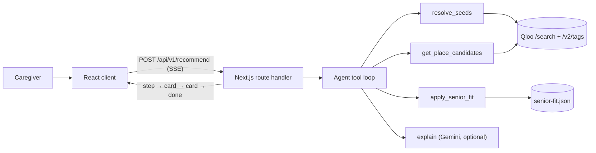

# Tablemate

<p align="center">
  <strong>Restaurant shortlists for older adults, grounded in taste and honest about what we don't know.</strong><br />
  Tablemate helps caregivers shortlist restaurants that fit personal taste and age-related dining needs, then prepares them to verify the match with a 30-second phone call.
</p>

<p align="center">
  <code>pnpm install</code> then <code>pnpm dev</code>, open <a href="http://localhost:3000">localhost:3000</a>
</p>

<p align="center">
  <a href="LICENSE"></a>
  
  
  
  
</p>

<p align="center">
  <a href="#quick-start">Quick start</a> ·
  <a href="#how-it-works">How it works</a> ·
  <a href="#demo-personas">Demo personas</a> ·
  <a href="#live-url">Live URL</a> ·
  <a href="#honesty-and-limits">Honesty and limits</a> ·
  <a href="#verification">Verification</a>
</p>

> [!NOTE]
> Not medical advice. The app never says a restaurant is "safe," "compliant," or "verified" for a medical condition. Every card shows an evidence label — reported, likely, or ask — and ends with a disclaimer to confirm needs by phone. Without a Qloo API key, every venue is clearly labeled fictional sample data.

## Overview

Tablemate is built for the Qloo Agentic Hackathon. It turns a few favorite tastes — an artist, a film, a restaurant, a cuisine — plus dining needs like softer texture, lower sodium, diabetic-friendly, quiet, or step-free access, into a short, ranked restaurant shortlist. Qloo's taste graph does the taste matching; a deterministic senior-fit layer applies evidence labels; an optional Gemini call writes plain-language taste reasons.

The judge path is one tap: open the URL, tap "Try Sylvia," and cards stream in. No accounts, no installs, no typing.

## Quick start

### Prerequisites

- Node.js 22 or newer
- pnpm

### Run

```bash
pnpm install
pnpm dev
```

Open http://localhost:3000. `pnpm install` installs dependencies; `pnpm dev` starts the Next.js dev server. The app runs immediately with no environment variables, API keys, or database.

Check readiness:

```bash
curl -s http://localhost:3000/api/health
# {"qloo":"mock","llm":"template","limits":"memory","version":"0.1.0"}
```

## Demo

The demo has three golden personas, one tap each.

| Step | Action | What to watch |
| --- | --- | --- |
| 1 | Open **Try Sylvia** on the landing page | Five cards stream in for Sylvia (soft texture, low sodium, diabetic-friendly, quiet, step-free) |
| 2 | Open a card | See the taste reason, evidence chips, and the "Your 30-second call" script |
| 3 | Tap **Directions** | A maps deep link opens for the venue |
| 4 | Tap **Show agent steps** | See each tool call — resolve seeds, get candidates, apply senior fit, explain — and what it contributed |

Other controls are **Build your own** (enter your own tastes and needs) and **Refresh** (re-run the stream). The agent-steps panel shows exactly which Qloo signals drove each card.

### Demo personas

| Persona | Age | Taste seeds | Needs | Location |
| --- | --- | --- | --- | --- |
| Sylvia | 78 | Miles Davis, *Casablanca*, Italian | soft texture, lower sodium, diabetic-friendly, quiet, step-free | Brooklyn, NY |
| Raj | 74 | Ravi Shankar, *Pather Panchali*, Indian | diabetic-friendly, regular texture, moderate noise | Edison, NJ |
| Margaret | 79 | Frank Sinatra, *The Sound of Music*, Italian | very soft / pureed, wheelchair, quiet | Chicago, IL |

The tokens are public fixture values, not secrets. Every persona needs is rendered as evidence labels on every card.

## Design choices

- **Evidence travels with the answer.** Every constraint on every card carries exactly one label: **reported** (backed by a Qloo tag or place field), **likely** (inferred from curated cuisine knowledge), or **ask** (unknown — added to the phone script). Nothing is ever called "safe" or "verified."
- **Qloo is visible.** Each card lists which Qloo entity or tag surfaced the pick, so the taste match is auditable, not magic.
- **The demo is deterministic.** Without API keys, every venue is fictional and labeled sample data, but the full agent flow still runs identically.
- **Integrity is inspectable.** Generated copy is scanned at runtime for forbidden words (safe, safely, guaranteed, compliant, approved, verified, certified) and replaced with a template if any appear.

## How it works



One serverless function handles the stream. The browser reads SSE events as they arrive, so preview cards show before the full shortlist is ready. The LLM (Gemini) only writes taste sentences and may reorder within a 0.10 score tolerance — it never invents venues or authors health claims.

## Features

- One-tap demo personas (Sylvia, Raj, Margaret) — no typing required
- Build-your-own taste profile with Qloo autocomplete and entity chips
- Needs controls: texture, sodium, diet, noise, mobility, optional free-text note
- Evidence-labeled chips on every card (reported / likely / ask)
- Streaming results: first card visible before the stream ends
- "Your 30-second call" script — copyable questions for the restaurant
- One-tap Call and Directions on every card
- Agent-steps panel showing tool calls, status, and timing
- Text size control (18–24 px), persisted locally
- Skip link, 48 px tap targets, AA contrast, works on mobile
- Fallbacks: Qloo down → labeled sample results; LLM down → templated explanations

## Configuration

| Variable | Required | Default | Purpose |
| --- | --- | --- | --- |
| `QLOO_API_KEY` | No | (mock mode) | Live Qloo taste graph access |
| `QLOO_BASE_URL` | No | `https://hackathon.api.qloo.com` | Qloo API base URL |
| `GEMINI_API_KEY` | No | (templated) | Optional natural-language taste explanations |
| `GEMINI_MODEL` | No | `gemini-2.5-flash` | Gemini model ID |
| `GEMINI_MAX_TOKENS` | No | `900` | Max tokens per explanation call |
| `DAILY_LLM_BUDGET` | No | `150000` | Daily explanation token cap |
| `UPSTASH_REDIS_REST_URL` | No | (in-memory) | Distributed rate limiting |
| `UPSTASH_REDIS_REST_TOKEN` | No | (in-memory) | Distributed rate limiting |

Never commit real key values. `.env*` files are ignored; `.env.example` is committed with empty values.

## Tech stack

- **Framework:** Next.js 15 App Router, React 19, TypeScript strict
- **Styling:** Tailwind CSS, Lucide icons
- **Validation:** Zod at every boundary
- **Testing:** Vitest (unit tests)
- **LLM:** Gemini REST API (optional; templated explanations without a key)
- **Taste graph:** Qloo hackathon API (`/search`, `/v2/tags`, `/v2/insights`)
- **Hosting:** Vercel

## Verification

| Gate | Command | Result |
| --- | --- | --- |
| Unit tests | `pnpm test` | 113 passed, 0 failed |
| Typecheck | `pnpm exec tsc --noEmit` | pass |
| Lint | `pnpm lint` | pass |
| Build | `pnpm build` | pass, 6 routes generated |
| Health endpoint | `curl https://tablemate-azure.vercel.app/api/health` | `{"qloo":"mock","llm":"template","limits":"memory","version":"0.1.0"}` |

## Honesty and limits

- **No health claims.** The app does not verify that any restaurant can meet a dietary, texture, or accessibility requirement. Evidence labels describe what the data says, not what the kitchen can do. Call ahead.
- **No persistent health data.** No health inputs are stored in URLs, localStorage, cookies, or server storage. Taste IDs and location go to Qloo; taste seeds, location, and the optional note go to Gemini if configured.
- **Mock mode is the default.** Without a Qloo API key, all venues are fictional and labeled sample data. The full agent flow still runs, but Qloo is not load-bearing until a key is configured.
- **Live Qloo key not yet issued.** The path to a key is to email support@qloo.com.

## Live URL

https://tablemate-azure.vercel.app

## Public repo

https://github.com/Divyanshu-Kumar14/Tablemate (MIT license)

## Hackathon submission

The live URL works without auth.

## License

MIT
