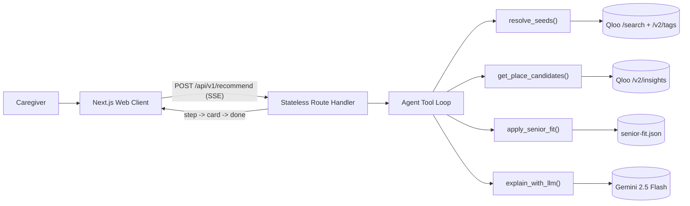

# Tablemate

**Restaurant shortlists for older adults, grounded in cultural taste and verified by phone.**

Tablemate helps family caregivers find restaurants that match an older adult's cultural preferences alongside physical dining requirements, then provides a targeted 30-second phone script to confirm texture, sodium, and accessibility before visiting.

[Live Demo](https://tablemate-azure.vercel.app) · [GitHub Repo](https://github.com/Divyanshu-Kumar14/Tablemate) · [Quick Start](#quick-start) · [How It Works](#how-it-works) · [Verification](#verification-and-quality-gates)

[](LICENSE)
[](https://nextjs.org)
[](https://www.typescriptlang.org)
[](vitest.config.ts)
[](https://qloo.com)

---

> **Important notice:** Tablemate is not medical advice. The application never labels a kitchen as "safe," "certified," or "compliant" for medical conditions like dysphagia. Instead, each requirement carries a clear evidence label (Reported, Likely, or Ask) and pairs with a short phone script to verify with restaurant staff before arrival.

---

## The Problem

When older adults experience chewing difficulty, high blood pressure, sensory overload, or mobility changes, dining out often stops entirely. Standard review platforms do not track dish texture, kitchen sodium flexibility, or quiet seating areas. Caregivers typically spend hours calling venues individually or settle for the same two familiar spots, increasing social isolation for their loved ones.

Tablemate bridges cultural identity and physical accessibility. By combining Qloo's 250M+ entity taste graph with a deterministic senior-fit evaluation layer, it surfaces dining rooms that honor who someone is while respecting how they eat.

---

## Quick Start

### Prerequisites
- Node.js 22 or newer
- pnpm 10 or newer

### Local Setup

```bash
git clone https://github.com/Divyanshu-Kumar14/Tablemate.git
cd Tablemate
pnpm install
pnpm dev
```

Open [http://localhost:3000](http://localhost:3000). The app runs immediately with built-in mock fallbacks if external API keys are not supplied.

Check health status:
```bash
curl -s http://localhost:3000/api/health
```

---

## Golden Personas (One-Tap Judge Flow)

You can test the complete system in under 30 seconds on the landing page without filling out forms:

| Persona | Profile & Location | Dining Requirements | Key Cultural Seeds |
| :--- | :--- | :--- | :--- |
| **Sylvia (78)** | Lives independently in Brooklyn, NY | Soft texture, lower sodium, diabetic-friendly, quiet room, step-free access | Miles Davis, *Casablanca*, Italian cuisine |
| **Raj (74)** | Lives with family in Edison, NJ | Diabetic-friendly, regular texture, moderate ambient noise | Ravi Shankar, *Pather Panchali*, Indian cuisine |
| **Margaret (79)** | Lives near family in Chicago, IL | Puréed/very soft texture, wheelchair access, quiet room | Frank Sinatra, *The Sound of Music*, Italian cuisine |

Clicking any persona runs the full recommendation loop, streaming preview cards within 2 seconds followed by natural-language taste explanations.

---

## How It Works



1. **Taste Seed Resolution:** The user's favorite artists, films, or cuisines resolve to canonical Qloo entity IDs and tags via `/search` and `/v2/tags`.
2. **Cultural Affinity Retrieval:** Qloo's `/v2/insights` endpoint queries for dining establishments in the target city that statistically correlate with those cultural seeds.
3. **Dining Venue Validation:** Non-dining establishments (places of worship, monuments, cemeteries) are filtered out, preserving genuine culinary candidates.
4. **Senior Fit Evaluation:** A transparent rule engine (`senior-fit.json`) inspects place tags, amenities, and cuisine styles, assigning an evidence status to every user requirement:
   - **Reported:** Directly corroborated by structured Qloo place tags (such as wheelchair access or quiet ambience).
   - **Likely:** Inferred from known culinary traditions (such as Italian risottos or polenta offering softer chewing options).
   - **Ask:** Not present in available datasets. Formats into a specific question for the phone call script.
5. **Streaming Presentation:** Initial cards stream over Server-Sent Events (SSE) immediately. A lightweight Gemini 2.5 Flash call provides a concise, plain-language explanation of why the venue matches the person's taste seeds.

---

## Business Model & Commercial Scalability (B2B2C)

While Tablemate is free for families, it targets significant operational bottlenecks across the $90B+ eldercare and assisted living sector:

- **Senior Living & Memory Care Operators ($499–$1,499/month per facility):**
  Activity directors and community concierges use Tablemate to organize resident excursions and supply visiting families with vetted dining itineraries tailored to varied mobility and texture needs.
- **Home Health & Non-Medical Caregiver Agencies ($15/caregiver/month):**
  Equips visiting aides with safe meal-outing recommendations, reducing hospital readmissions tied to choking or hypertensive sodium spikes.
- **Medicare Advantage (MA) Payers:**
  Offered as a supplemental Social Determinants of Health (SDOH) benefit to curb the chronic isolation and nutritional decline common among older adults living alone.

---

## Environment Configuration

| Variable | Required | Default | Purpose |
| :--- | :---: | :--- | :--- |
| `QLOO_API_KEY` | Optional | (mock mode) | Access key for Qloo hackathon API (`https://hackathon.api.qloo.com`) |
| `QLOO_BASE_URL` | Optional | `https://hackathon.api.qloo.com` | Base URL for Qloo endpoints |
| `GEMINI_API_KEY` | Optional | (templated) | Access key for Gemini natural-language taste explanations |
| `GEMINI_MODEL` | Optional | `gemini-2.5-flash` | Gemini model identifier |
| `GEMINI_MAX_TOKENS` | Optional | `900` | Maximum token limit per explanation request |
| `DAILY_LLM_BUDGET` | Optional | `150000` | Daily token spend cap across serverless instances |
| `UPSTASH_REDIS_REST_URL` | Optional | (in-memory) | Redis endpoint for distributed rate limiting |
| `UPSTASH_REDIS_REST_TOKEN` | Optional | (in-memory) | Redis authentication token |

---

## Verification & Quality Gates

Every component is validated through automated tests and strict typing:

| Check | Command | Verified Result |
| :--- | :--- | :--- |
| **Unit Tests** | `pnpm test` | 115 passing tests across 10 test suites |
| **Typecheck** | `pnpm exec tsc --noEmit` | Clean exit (0 errors) |
| **Linter** | `pnpm lint` | Clean exit (0 warnings) |
| **Production Build** | `pnpm build` | 6 routes generated successfully |
| **Production Health** | `curl https://tablemate-azure.vercel.app/api/health` | `{"qloo":"ok","llm":"configured","limits":"memory","version":"0.1.0"}` |

---

## License

This project is licensed under the [MIT License](LICENSE).
